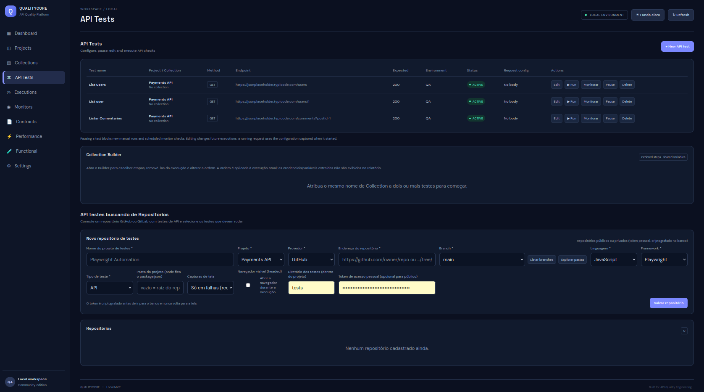

O módulo **API Tests** permite configurar e executar chamadas HTTP individuais.

# Tela

## Configuração

O formulário suporta, conforme implementado no projeto:

- Project associado.
- Métodos HTTP, incluindo `HEAD` e `OPTIONS`.
- URL de destino.
- Query Parameters.
- Headers.
- Autenticação `NONE`, `BEARER` e `BASIC`.
- Request Body.
- Timeout.
- Limite máximo de tempo de resposta (`maxResponseTimeMs`).
- Assertions.

## Request Preview

A prévia acompanha método, URL e query parameters. Valores de headers não são exibidos na prévia, evitando revelar credenciais configuradas nesses campos.

## Execução

A execução individual é realizada pelo serviço de execução e seus resultados são persistidos no histórico. O módulo Executions permite consultar as execuções realizadas.

## API

- `GET /api/tests`
- `POST /api/tests`
- `PUT /api/tests/{id}`
- `PATCH /api/tests/{id}/enabled`
- `DELETE /api/tests/{id}`
- `POST /api/executions/{testId}`

## Cuidados

- Execute somente contra APIs que você está autorizado a testar.
- Evite inserir tokens ou dados pessoais em exemplos.
- Proteja credenciais e revise o armazenamento e a exibição de dados sensíveis antes de utilizar em ambiente compartilhado.

Consulte [Assertions](Assertions) e [Executions](Executions).
