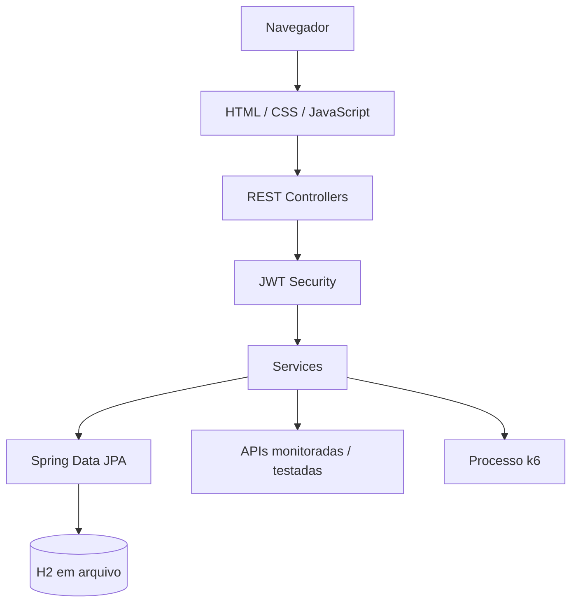

## Visão geral

O QUALITYCORE utiliza uma aplicação Spring Boot que serve o frontend estático e disponibiliza endpoints REST para as operações da plataforma.

## Camadas

### Frontend

Arquivos em `src/main/resources/static/`:
- `index.html`
- `styles.css`
- `app.js`
- `assertion-builder.js`
- `execution-checks.js`
- `latency-chart.js`
- `perf-charts.js`
- `chart-tooltip.js`

### Controllers

O pacote `api` contém os controllers REST para autenticação, projetos, testes, execuções, Collections, monitores, dashboard, contratos, performance e health.

### Services

O pacote `service` concentra regras de execução, avaliação de assertions, validação de contratos, importação OpenAPI, agendamento de monitores, integração k6, estatísticas e relatórios.

### Persistência

Entidades JPA são mapeadas por repositories Spring Data JPA e persistidas no H2 local.

### Segurança

O pacote `security` implementa hashing de senhas, emissão/validação de JWT, serviço de autenticação, interceptor e configuração web.

## Fluxos principais

- API Test: interface → controller → serviço de execução → chamada HTTP → avaliação → persistência.
- Collection: controller → serviço de execução sequencial → API Tests → política de falha → relatório.
- Monitor: scheduler → API Test ou Collection → gravação de verificação → Dashboard.
- Contract: contrato JSON/OpenAPI → importador/validador → execução das operações → histórico/cobertura.
- Performance: configuração → gerador de script → processo k6 → resumo/timeline/relatório.

## Limites arquiteturais

A aplicação é um MVP local, com frontend servido pelo mesmo processo e banco H2 em arquivo. Não há evidência nesta versão de arquitetura distribuída, escalabilidade horizontal, isolamento multi-tenant ou observabilidade distribuída.
