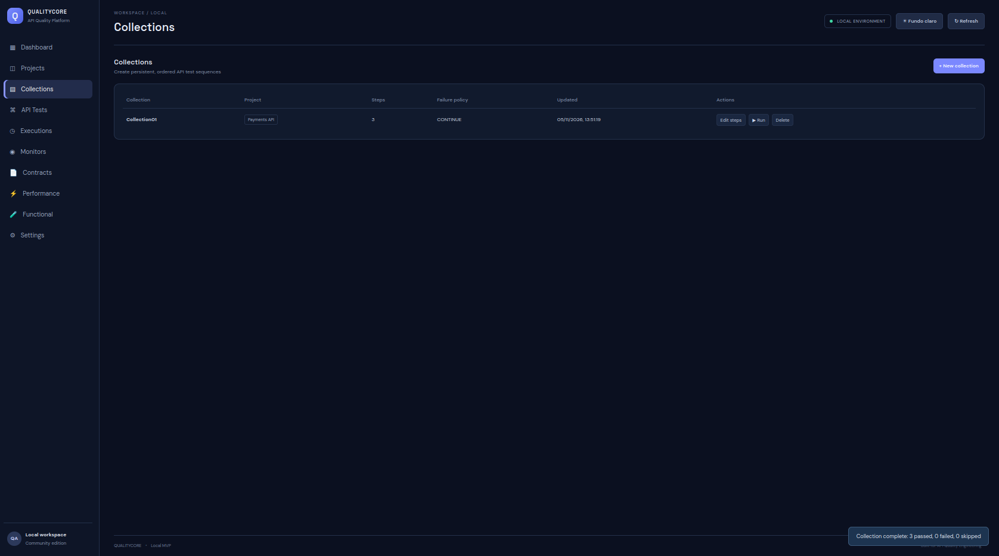

Collections agrupam API Tests de um mesmo Project e executam suas etapas em uma sequência persistida.

## Tela

## Funcionalidades

- Criar e editar Collections.
- Definir nome único dentro do Project (comparação sem diferenciar maiúsculas/minúsculas).
- Adicionar e remover API Tests.
- Reordenar etapas usando controles para mover para cima/baixo.
- Definir política de falha `STOP` ou `CONTINUE`.
- Executar a Collection e consultar o relatório.

## Política de falha

| Política | Comportamento |
|---|---|
| `STOP` | Interrompe o fluxo após uma etapa reprovada |
| `CONTINUE` | Prossegue para as etapas seguintes após falha |

A sequência é propriedade da Collection. Uma mesma API Test pode pertencer a mais de uma Collection, e cada fluxo mantém sua própria ordem.

## Relatório

O relatório por etapa apresenta status HTTP, tempo de resposta, assertions, valores esperados/obtidos e motivos de falha.

## Monitores de Collection

Um Monitor pode apontar para uma Collection. Nesse caso, executa as etapas na ordem salva e usa a política de falha da Collection. A latência registrada representa a soma das etapas efetivamente executadas.

## API

- `GET /api/collections`
- `POST /api/collections`
- `PUT /api/collections/{id}`
- `POST /api/collections/{id}/run`
- `POST /api/collections/run`
- `DELETE /api/collections/{id}`

## Limitações atuais

- A reordenação é feita por controles up/down, não por drag-and-drop.
- Não há grafo explícito de dependências nem política de pular etapas dependentes.
- Em monitor de Collection, as etapas utilizam timeout fixo de 10 segundos, conforme limitação registrada no README da versão.
