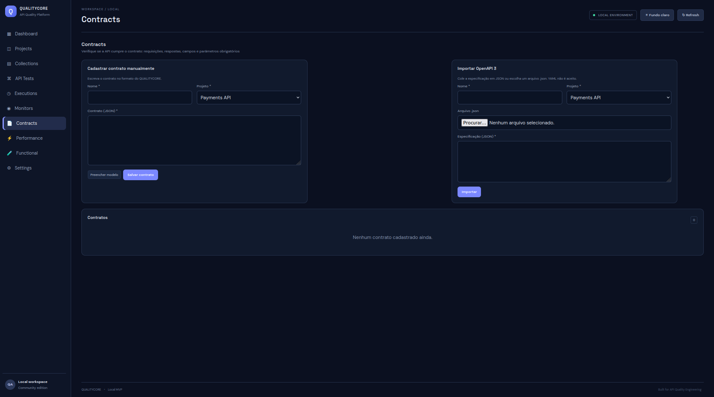

O módulo **Contracts** permite verificar se uma API observada está em conformidade com um contrato declarado.

# Tela

## Formas de cadastro

1. **Manual:** inserir o contrato no formato JSON.
2. **Importação OpenAPI 3:** colar uma especificação OpenAPI em JSON ou selecionar um arquivo `.json`.

A importação resolve referências internas `#/components/...`. Referências externas são recusadas para manter o documento autocontido.

**YAML não é aceito nesta versão.** Converta a especificação para JSON antes da importação.

## Verificações

O verificador avalia, por operação:

- Se o exemplo de requisição respeita o schema declarado.
- Se o status HTTP recebido está entre os status previstos.
- Se o corpo da resposta respeita o schema declarado.
- Se a API recusa (4xx) requisições sem campos obrigatórios do body.
- Se a API recusa (4xx) requisições sem parâmetros query obrigatórios.

Quando não há exemplos no contrato, valores são gerados a partir dos schemas, considerando os campos obrigatórios.

## Recursos de schema documentados

`type`, `required`, `properties`, `items`, `enum`, `minLength`, `maxLength`, `minimum`, `maximum`, `pattern` e formatos `email`, `uuid`, `date` e `date-time`.

Quando `additionalProperties` é `false`, campos não declarados no schema reprovam a validação.

## Histórico e cobertura

Cada verificação é registrada. A interface apresenta resultado da última execução, cobertura das operações aprovadas na última execução e gráfico de aprovadas/reprovadas ao longo das verificações.

## API

- `GET /api/contracts`
- `GET /api/contracts/{id}`
- `POST /api/contracts`
- `POST /api/contracts/import-openapi`
- `PUT /api/contracts/{id}`
- `POST /api/contracts/{id}/run`
- `GET /api/contracts/{id}/runs`
- `GET /api/contracts/{id}/coverage`
- `DELETE /api/contracts/{id}`

## Limitações

- Não há matriz de dependências entre consumidores e provedores.
- Não há cobertura de endpoints baseada em tráfego real de produção.
- OpenAPI YAML e referências externas não são aceitos.
- O subconjunto de keywords e formatos de JSON Schema suportado está descrito acima; não se deve presumir suporte integral à especificação JSON Schema.
