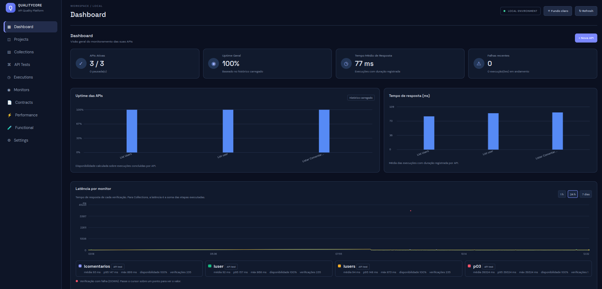
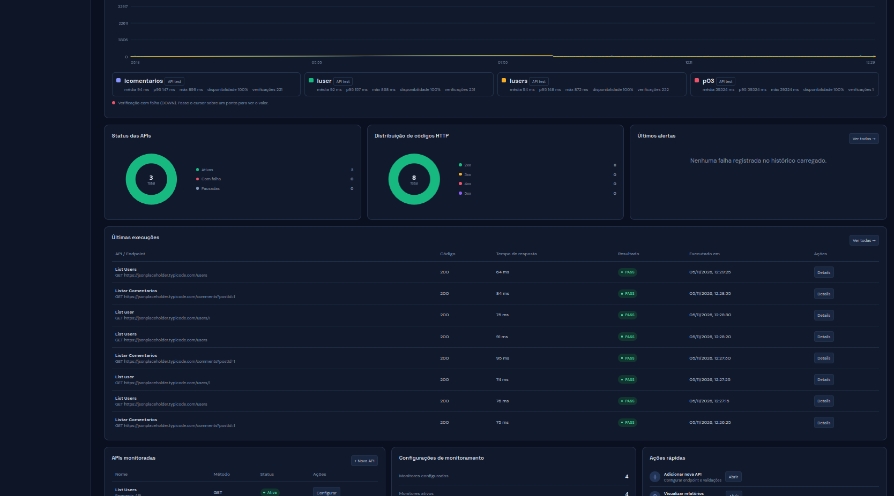

O Dashboard apresenta um resumo operacional e informações de latência dos monitores.

# Tela

## Resumo

O backend disponibiliza o endpoint `GET /api/dashboard/summary` para os dados de resumo utilizados pela interface.

## Latência por monitor

O painel apresenta séries de latência para monitores e permite selecionar janelas de tempo. A API `GET /api/dashboard/latency?hours=24` disponibiliza dados por monitor; a janela aceita de 1 a 168 horas e a implementação limita a série a até 2.000 pontos por monitor, priorizando os mais recentes.

A legenda apresenta estatísticas do monitor, incluindo média, p95, máximo, disponibilidade e quantidade de verificações. Verificações DOWN são destacadas. É possível abrir o detalhe de um monitor de Collection para visualizar as APIs que compõem o fluxo.

## Interação

- Atualização manual pelo botão Refresh.
- Alternância entre tema claro e escuro.
- Clique na legenda para abrir/fechar detalhes de um monitor quando aplicável.

## Interpretação

- Latência representa o tempo medido para a verificação.
- Em monitor de Collection, a latência representa a soma das etapas executadas (tempo de ponta a ponta do fluxo).
- Histórico de detalhes por API em Collection existe a partir da versão 0.18.0; verificações antigas podem não possuir `stepsJson`.

## Endpoint relacionado

- `GET /api/dashboard/summary`
- `GET /api/dashboard/latency?hours={1..168}`

Consulte [Monitors](Monitors) e [Performance Metrics](Performance-Metrics).
