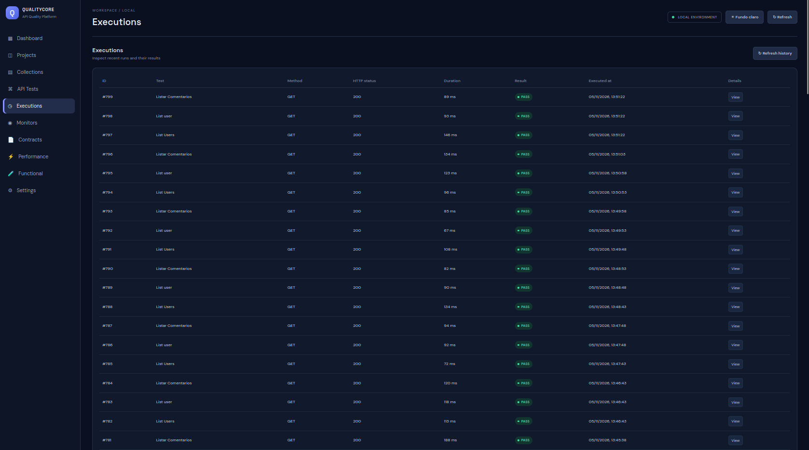

A área **Executions** permite consultar o histórico das execuções de API Tests.

# Tela

## Informações de execução

Os resultados incluem, conforme o tipo de execução e os dados disponíveis:

- Resultado geral (PASS/FAIL).
- Status HTTP.
- Tempo de resposta.
- Detalhamento das assertions.
- Valores esperados e obtidos.
- Motivos de falha.

O modelo `Execution` persiste os dados da execução. A partir da versão 0.12.0, os resultados estruturados das verificações são armazenados em `checksJson`. Execuções anteriores podem não conter esse detalhamento estruturado.

## Cancelamento

O controller de execuções disponibiliza uma rota de cancelamento por identificador:

- `POST /api/executions/{executionId}/cancel`

A execução individual é iniciada por:

- `POST /api/executions/{testId}`

## Diagnóstico

Ao investigar uma falha, compare o resultado HTTP, tempo medido, assertions reprovadas e mensagens registradas. Uma falha de assertion não deve ser confundida automaticamente com indisponibilidade do serviço.
