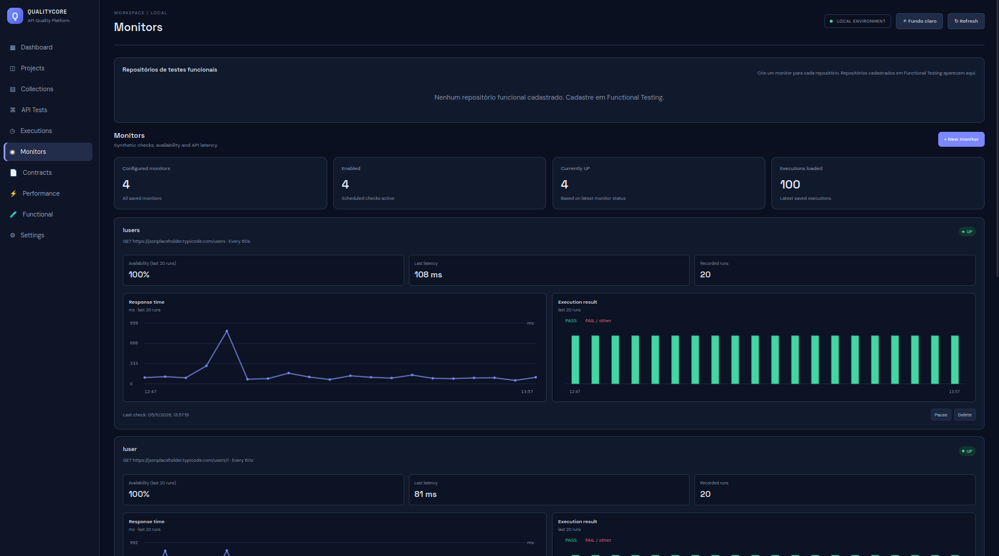

# Monitors

O módulo Monitors realiza verificações sintéticas recorrentes sobre um alvo cadastrado.

# Tela

## Tipos de alvo

Um monitor possui exatamente um alvo:
- Um API Test; ou
- Uma Collection.

Enviar ambos os identificadores, ou nenhum, é inválido.

## Funcionamento

O scheduler executa verificações conforme a configuração do monitor e grava histórico em `monitor_checks`. O resultado é apresentado como UP ou DOWN.

Para um monitor de Collection:
- As etapas seguem a ordem salva na Collection.
- A política `STOP` ou `CONTINUE` é respeitada.
- O monitor fica UP quando todas as etapas executadas passam.
- A latência é a soma dos tempos das etapas executadas.
- Etapas puladas não entram na soma.

## Dashboard e detalhe por API

O Dashboard apresenta histórico de latência. Para monitores de Collection, a interface pode mostrar latência por API e resultado da última execução de cada etapa. O detalhe granular é armazenado a partir da versão 0.18.0.

## API

- `GET /api/monitors`
- `POST /api/monitors`
- `PATCH /api/monitors/{id}/enabled`
- `DELETE /api/monitors/{id}`
- `GET /api/dashboard/latency?hours=24`

## Limitações conhecidas

- Monitores de Collection utilizam timeout fixo de 10 segundos por etapa.
- O histórico `monitor_checks` não possui limpeza automática.
- Detalhes por etapa não estão disponíveis para verificações anteriores à versão 0.18.0.

## Uso responsável

Monitore apenas sistemas sob sua responsabilidade ou para os quais tenha autorização. Considere frequência, timeout e impacto sobre o serviço monitorado.
