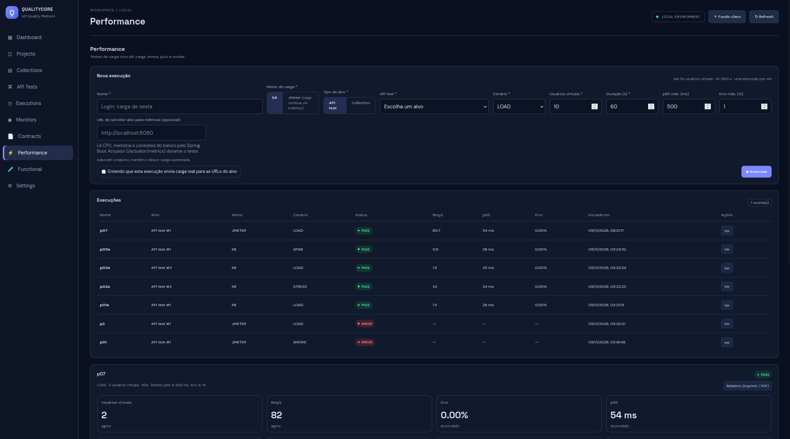

# Performance Engineering

O módulo Performance executa cenários de carga com k6, acompanha a execução e disponibiliza resultados e relatórios.

# Tela

## Capacidades

- Configuração e execução de cenários.
- Geração de script k6 pela aplicação.
- Localização/instalação do executável k6.
- Limites de VUs e duração.
- Acompanhamento da execução e timeline.
- Resumo de métricas e relatório HTML.

## Perfis de carga

O histórico de desenvolvimento registra cenários como Smoke, Load, Stress e Spike. A disponibilidade e os parâmetros de cada perfil devem ser confirmados no formulário da versão em execução; não extrapole perfis para capacidades que não estejam expostas na interface.

## Limites de segurança

Valores padrão definidos em `application.properties`:
- `qa.perf.max-vus=50`
- `qa.perf.max-duration-seconds=600`

Esses limites são controles locais da aplicação e não substituem planejamento de carga, autorização do alvo ou avaliação da capacidade do gerador.

## Fluxo de execução

1. Acesse Performance.
2. Configure o alvo e o cenário.
3. Revise usuários virtuais, duração e demais parâmetros.
4. Confirme a execução.
5. Acompanhe status, timeline e métricas.
6. Consulte o detalhe e o relatório HTML.

## k6

A aplicação monta o script e executa o binário k6. A versão 2.3.0 foi usada em uma validação real documentada no histórico de desenvolvimento. A propriedade `qa.k6.path` permite indicar um caminho explícito; vazia, a aplicação procura o binário no PATH e pode tentar baixar uma versão.

## API

- `GET /api/performance/limits`
- `GET /api/performance/runs`
- `GET /api/performance/runs/{id}`
- `GET /api/performance/runs/{id}/timeline`
- `POST /api/performance/runs`
- `POST /api/performance/runs/{id}/stop`
- `GET /api/performance/runs/{id}/report`

## Cuidados

Faça testes somente em ambientes autorizados. Evite executar cenários de carga em produção sem aprovação, janela, limites e plano de interrupção.
