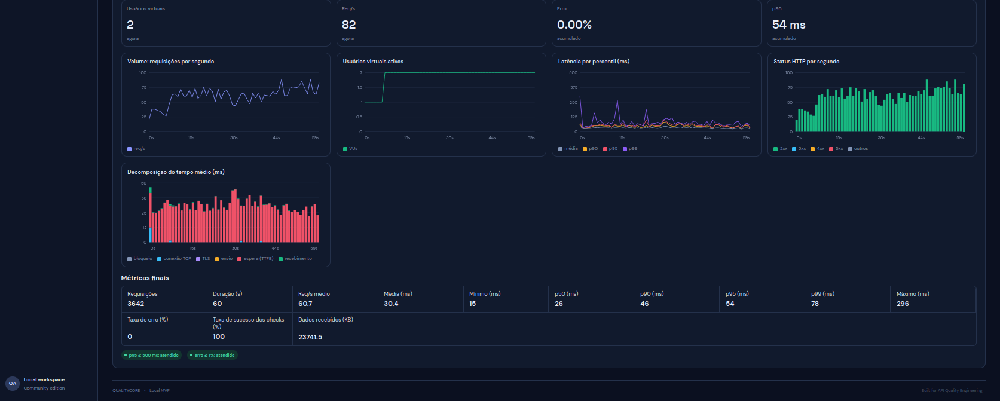

# Métricas de Performance

Esta página descreve os indicadores apresentados ou processados pelo módulo de performance. A disponibilidade de cada série depende do resultado efetivamente produzido pelo k6 e do agregador utilizado.

# Tela

## Métricas de carga

| Métrica | Significado |
|---|---|
| Virtual Users (VUs) | Usuários virtuais ativos no cenário |
| Requests | Quantidade de requisições realizadas |
| Requests per Second (RPS) | Taxa de requisições por segundo |
| Average response time | Tempo médio de resposta |
| Min / Max | Menor e maior tempo medido |
| p90 / p95 / p99 | Percentis da distribuição dos tempos de resposta |
| HTTP failures / error rate | Requisições classificadas como falha conforme a métrica do teste |
| Checks | Resultado das verificações `check()` do k6, quando a métrica é exposta pelo script |

## Percentis

- **p90:** 90% das observações ficam no valor ou abaixo dele.
- **p95:** 95% das observações ficam no valor ou abaixo dele.
- **p99:** 99% das observações ficam no valor ou abaixo dele.

Percentis ajudam a revelar caudas de latência que a média pode esconder.

## Checks versus falhas HTTP

A taxa de checks aprovados é diferente da taxa de requisições HTTP bem-sucedidas. Um request pode retornar HTTP 200 e falhar em uma regra funcional; inversamente, uma métrica de falha HTTP não representa necessariamente todos os checks definidos no script.

A versão deve expor e agregar explicitamente a métrica de checks para que o painel apresente essa taxa. Não deduza a taxa de checks apenas pela taxa de erros HTTP.

## Métricas de infraestrutura

O projeto inclui `TargetMetricsSampler` e captura de métricas do processo/ambiente-alvo descritas no histórico, incluindo CPU do processo, memória JVM e conexões do HikariCP. Essas medidas não equivalem a telemetria completa do host, do banco de dados remoto ou de todos os componentes de infraestrutura.

Para métricas externas de CPU, memória do host, banco, rede e containers, é necessário instrumentar os respectivos serviços e integrar fontes de observabilidade apropriadas.

## Interpretação

Avalie métricas em conjunto: carga aplicada, volume de requisições, distribuição de latência, erros, checks e recursos observados. Compare execuções sob condições equivalentes.
