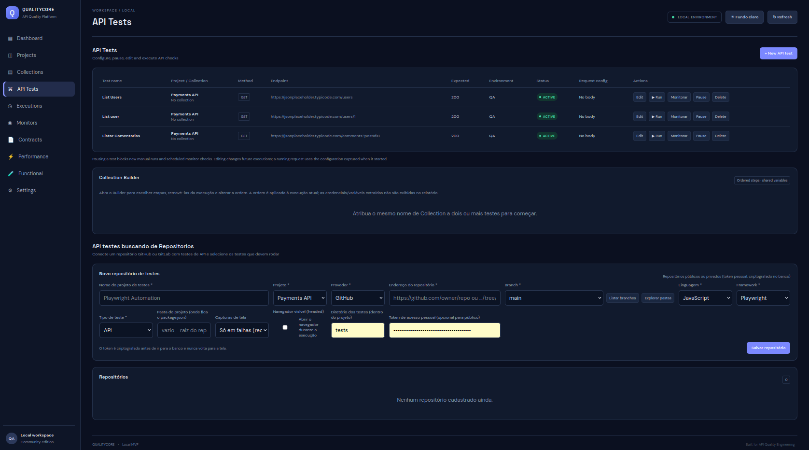

Projects agrupam os recursos de teste da aplicação.

## Tela

## Funcionalidades

- Listar projetos.
- Criar projeto.
- Excluir projeto.
- Associar API Tests e Collections a um projeto.

## Fluxo sugerido

1. Acesse **Projects**.
2. Crie um projeto com nome que identifique o sistema ou domínio testado.
3. Cadastre API Tests nesse contexto.
4. Reutilize os testes em Collections do mesmo projeto.

## API

- `GET /api/projects`
- `POST /api/projects`
- `DELETE /api/projects/{id}`

Os campos exatos do payload devem ser consultados em `ProjectController` e na entidade `Project`.

## Observação

A associação entre Collections e API Tests é limitada ao mesmo Project durante a seleção das etapas.
